# 📐 Awesome-CAD-Drafting-Engineering-Visualization 🚀

<p align="center">
  <a href="https://github.com/ishandutta2007/Awesome-Awesome-Awesome"></a>
  <a href="https://discord.gg/jc4xtF58Ve"></a>
  <a href="https://github.com/ishandutta2007/Awesome-CAD-Drafting-Engineering-Visualization/stargazers"></a>
  <a href="https://github.com/ishandutta2007/Awesome-CAD-Drafting-Engineering-Visualization/network/members"></a>
  <a href="https://github.com/ishandutta2007/Awesome-CAD-Drafting-Engineering-Visualization/blob/main/LICENSE"></a>
  <a href="https://github.com/ishandutta2007"></a>
</p>

<p align="center">
  
</p>

---

## 🧭 Overview & Introduction

Welcome to **Awesome-CAD-Drafting-Engineering-Visualization**, an authoritative, community-curated catalog of **SaaS/hosted CAD platforms**, **computational geometry engines**, and **open-source engineering visualization toolkits**. 

Whether you are an architect designing BIM layouts, a mechanical engineer building complex parametric assemblies, a civil engineer simulating massive infrastructure digital twins, or a developer constructing browser-based WebGL/WebAssembly CAD viewports, this repository indexes the leading software, libraries, and frameworks across the industry.

---

## 📊 Sector Overview & Market Dynamics

> The global Computer-Aided Design (CAD) and 3D modeling software market is estimated at **$10.5B – $12.2B (2025–2026)**, expanding at a steady **~6.5% CAGR** toward **$18B+ by 2034**. The sector exhibits a **moderately concentrated oligopoly** at the enterprise tier—dominated by incumbents like **Autodesk, Dassault Systèmes, PTC, Hexagon, and Bentley Systems**—alongside a rapidly proliferating **fragmented ecosystem** of cloud-native browser CAD solutions, WebGL/WebGPU viewing pipelines, and community-driven open-source geometry kernels.

---

## 📑 Table of Contents

- [🧭 Overview & Introduction](#-overview--introduction)
- [📊 Sector Overview & Market Dynamics](#-sector-overview--market-dynamics)
- [☁️ SaaS & Hosted Platforms](#️-saas--hosted-platforms)
- [💻 Open-Source GitHub Projects](#-open-source-github-projects)
- [🛠️ Architectural Blueprints & Framework Recipes](#️-architectural-blueprints--framework-recipes)
- [🤝 How to Contribute](#-how-to-contribute)
- [💖 Support & Share](#-support--share)
- [📈 Star History](#-star-history)
- [⚠️ Disclaimer](#️-disclaimer)

---

## ☁️ SaaS & Hosted Platforms

Below is a breakdown of the leading hosted CAD drafting and digital-twin platforms, ranked in descending order by parent company market capitalization / corporate scale.

| Platform | Parent Company / Vendor | Company Size (Market Cap / Valuation) | Starting Pricing (Paid Tiers) | Free Tier / Trial Limits | Key Capabilities |
| :--- | :--- | :--- | :--- | :--- | :--- |
| **[AutoCAD Web](https://web.autocad.com)** | Autodesk (NASDAQ: ADSK) | **~$63 Billion** | $10/mo or $100/yr (also bundled with AutoCAD / LT desktop at $540+/yr) | **Free DWG Viewer forever** (view, pan, zoom, measure, layer inspect; editing locked) or **30-day full-feature free trial** | Browser-native 2D/3D DWG drafting, command-line drafting tools, layer management, and cloud cloud sync (Drive, OneDrive, Box). |
| **[Autodesk Forma](https://www.autodesk.com/products/forma/overview)** | Autodesk (NASDAQ: ADSK) | **~$63 Billion** | $115/mo or $925/yr (Forma Design Collaboration / AEC Collection) | **30-day free trial** with full early-stage conceptual massing and AI environmental analytics (non-commercial evaluation only) | AI-powered conceptual urban massing, sunlight/microclimate/wind simulation, and bi-directional Revit synchronization. |
| **[DraftSight Cloud](https://www.draftsight.com)** | Dassault Systèmes (Euronext: DSY.PA) | **~$40 Billion** | $299/yr ($24.90/mo billed annually) for DraftSight Professional | **30-day free trial** with full 2D drafting and 3D modeling features; requires paid license renewal upon expiration | Professional DWG-native 2D/3D CAD drafting connected directly to the 3DEXPERIENCE cloud platform for revision control and PDM. |
| **[BricsCAD Cloud & 24/7](https://www.bricsys.com)** | Hexagon AB / Bricsys (Nasdaq Stockholm: HEXA B) | **~$23 Billion** | $345/yr (BricsCAD Lite); Bricsys 24/7 cloud priced by storage tiers (e.g. 10GB/30GB/60GB) | **30-day free trial** of BricsCAD Ultimate with full 2D/3D features; downgrades to perpetual view-only mode post-trial | DWG-native 2D drafting and 3D direct BIM modeling paired with Bricsys 24/7 unlimited-user cloud collaboration and sheet automation. |
| **[Onshape](https://www.onshape.com)** | PTC Inc. (NASDAQ: PTC) | **~$21 Billion** | $1,500/yr per user (Standard tier, billed annually) | **Free Forever plan** for hobbyists/open-source makers; strictly non-commercial with unlimited public storage, but **all documents are 100% public** (capped at 10 private files / 100MB) | 100% browser-based parametric 3D CAD with built-in version control, Git-style branching/merging, real-time collaboration, and sheet drawings. |
| **[SketchUp Web](https://www.sketchup.com/products/sketchup-for-web)** | Trimble Inc. (NASDAQ: TRMB) | **~$18 Billion** | $119/yr ($9.90/mo equivalent) for SketchUp Go | **Free Forever plan** (SketchUp Free web) with **10 GB Trimble Connect cloud storage**, standard 3D web tools, STL export; non-commercial only (DWG export & Outliner locked) | Lightweight web-based 3D surface modeling, 3D Warehouse component library access, and Trimble Connect project synchronization. |
| **[Bentley Systems iTwin](https://www.bentley.com/software/itwin-platform/)** | Bentley Systems (NASDAQ: BSY) | **~$12 Billion** | $199/mo (Standard Developer plan includes 200 credits/mo, 50 GB data, 1 TB reality data) | **Free Community Subscription** providing **100 credits/mo**, **10 GB cloud storage**, **100 GB reality data**, capped at 500 API calls/min; non-commercial developer use | Enterprise infrastructure digital-twin platform, large-scale reality mesh streaming, iModel schema synchronization, and 4D construction sequencing. |
| **[Vectorworks Cloud Services](https://www.vectorworks.net/cloud-services)** | Nemetschek Group (Frankfurt: NEM) | **~$12 Billion** | $90/mo ($1,080 billed annually) for Vectorworks Fundamentals | **Free Forever plan** providing **10 GB cloud storage**, Nomad mobile app access, panoramic rendering viewing, and PDF export for free account holders | Cloud processing pipeline, distributed rendering, 3D web walkthrough generation, and mobile CAD drawing markups for architects and stage designers. |
| **[FreeCAD Cloud Workspaces](https://freecad.org)** | FreeCAD Open Ecosystem | **Open Ecosystem / Non-profit** | Community self-hosted / VDI streaming (compute instance hosting costs typically ~$15–$35/mo on AWS/Hetzner) | **100% Free and Open Source forever** (GPL / LGPL licenses); zero commercial subscription restrictions or private file lockouts | Browser-streamed or hosted virtual desktop infrastructure (VDI) running FreeCAD for remote parametric modeling, Python scripting, and STEP interchange. |

---

## 💻 Open-Source GitHub Projects

The premier open-source repositories powering the modern CAD drafting and engineering visualization landscape. Ranked in descending order by GitHub stargazers count, with real-time social badges linking directly to their respective stargazers pages.

| Repository | GitHub Stars | License | Primary Tech Stack | Description |
| :--- | :---: | :---: | :---: | :--- |
| **[FreeCAD](https://github.com/FreeCAD/FreeCAD)** | [](https://github.com/FreeCAD/FreeCAD/stargazers) | LGPL-2.0+ | C++, Python, Qt, OCCT | Flagship open-source parametric 3D CAD modeler featuring constraint sketcher, PartDesign, TechDraw blueprint generator, FEM, and extensive Python APIs. |
| **[Cesium](https://github.com/CesiumGS/cesium)** | [](https://github.com/CesiumGS/cesium/stargazers) | Apache-2.0 | JavaScript, WebGL, glTF | Industrial-grade 3D geospatial & infrastructure digital twin visualization engine supporting 3D Tiles, massive point clouds, and precision terrain geometry. |
| **[OpenSCAD](https://github.com/openscad/openscad)** | [](https://github.com/openscad/openscad/stargazers) | GPL-2.0 | C++, CSG, CGAL, Qt | The programmer's solid 3D CAD compiler. Generates parameterized solid models from declarative scripts via Constructive Solid Geometry (CSG) and DXF/SVG exports. |
| **[LibreCAD](https://github.com/LibreCAD/LibreCAD)** | [](https://github.com/LibreCAD/LibreCAD/stargazers) | GPL-2.0 | C++, Qt, DXF | High-performance, lightweight 2D CAD drafting system tailored for architectural blueprints, mechanical schematics, precision snapping, and multi-layer DXF drawing. |
| **[GDAL](https://github.com/OSGeo/gdal)** | [](https://github.com/OSGeo/gdal/stargazers) | MIT / X11 | C++, C, Python | Foundational geospatial and CAD vector/raster translation library powering geospatial coordinate transforms, DXF/DWG/DGN ingestion, and engineering GIS cartography. |
| **[CadQuery](https://github.com/CadQuery/cadquery)** | [](https://github.com/CadQuery/cadquery/stargazers) | Apache-2.0 | Python, OpenCASCADE (OCCT) | Intuitive Python parametric B-Rep CAD scripting framework based on OpenCASCADE for algorithmic 3D assemblies, technical 2D drawings, and STEP/STL generation. |
| **[Potree](https://github.com/potree/potree)** | [](https://github.com/potree/potree/stargazers) | FreeBSD | JavaScript, WebGL, Three.js | WebGL-based octree point cloud renderer for massive aerial LIDAR scans, infrastructure laser surveying, and industrial plant dimensional inspection. |
| **[CloudCompare](https://github.com/CloudCompare/CloudCompare)** | [](https://github.com/CloudCompare/CloudCompare/stargazers) | GPL-2.0 | C++, Qt, OpenGL | 3D point cloud and triangular mesh inspection suite designed for geometric comparison, LiDAR metrology, CAD surface alignment, and deformation analysis. |
| **[SolveSpace](https://github.com/solvespace/solvespace)** | [](https://github.com/solvespace/solvespace/stargazers) | GPL-3.0 | C++, OpenGL | Ultra-lightweight constraint-based 2D and 3D parametric CAD modeler with integrated planar mechanism kinematics simulation, toolpath generation, and STEP export. |
| **[build123d](https://github.com/gumyr/build123d)** | [](https://github.com/gumyr/build123d/stargazers) | Apache-2.0 | Python, OpenCASCADE | Modern, Pythonic boundary-representation (B-Rep) modeling library featuring context-manager syntax, 2D drafting, 3D complex fillets, and automated STEP exports. |
| **[Online3DViewer](https://github.com/kovacsv/Online3DViewer)** | [](https://github.com/kovacsv/Online3DViewer/stargazers) | MIT | JavaScript, WebGL, Three.js | Zero-dependency browser-based 3D CAD & mesh viewer supporting STEP, IGES, STL, OBJ, glTF, PLY, 3DM, and IFC formats with interactive model measuring tools. |
| **[dimensional-drawing](https://github.com/enesozturk/dimensional-drawing)** | [](https://github.com/enesozturk/dimensional-drawing/stargazers) | MIT | TypeScript, SVG | Programmatic technical drafting library engineered for generating Apple-style dimensioned drawings, mechanical callouts, measurement lines, and UI schematics. |
| **[Dune 3D](https://github.com/dune3d/dune3d)** | [](https://github.com/dune3d/dune3d/stargazers) | GPL-3.0 | C++, OpenCASCADE | Modern, standalone parametric 3D CAD application utilizing a fast 2D constraint solver, intuitive sketcher, STEP import/export, and clean desktop ergonomics. |
| **[QCAD](https://github.com/qcad/qcad)** | [](https://github.com/qcad/qcad/stargazers) | GPL-3.0 | C++, Qt, ECMAScript | Battle-tested 2D CAD platform dedicated to mechanical schematics, architectural drawings, DWG/DXF compatibility, and automated JavaScript drafting plugins. |
| **[ParaView](https://github.com/Kitware/ParaView)** | [](https://github.com/Kitware/ParaView/stargazers) | BSD-3-Clause | C++, VTK, Qt, Python | Industry-standard scientific data analysis and massive 3D engineering visualization platform for finite element analysis (FEA), CFD fluid meshes, and structural stresses. |
| **[ezdxf](https://github.com/mozman/ezdxf)** | [](https://github.com/mozman/ezdxf/stargazers) | MIT | Python, C-Extensions | Comprehensive Python package to read, create, modify, render, and dimension AutoCAD DXF drawings across all R12 through R2018 specifications. |
| **[BRL-CAD](https://github.com/BRL-CAD/brlcad)** | [](https://github.com/BRL-CAD/brlcad/stargazers) | LGPL / BSD | C, C++ | Over 40 years of battle-tested open-source combinatorial constructive solid geometry (CSG) modeling, raytracing, and ballistic engineering geometric analysis. |
| **[OpenCascade.js](https://github.com/donalffons/opencascade.js)** | [](https://github.com/donalffons/opencascade.js/stargazers) | MIT / LGPL | WebAssembly, C++, JS | WebAssembly port of the industrial-grade Open CASCADE Technology (OCCT) 3D CAD kernel for client-side browser B-Rep modeling, booleans, and STEP/IGES parsing. |
| **[iTwin.js Core](https://github.com/iTwin/itwinjs-core)** | [](https://github.com/iTwin/itwinjs-core/stargazers) | Apache-2.0 | TypeScript, WebGL | Bentley's open-source TypeScript SDK for building interactive 3D digital-twin web apps, synchronizing BIM models, and streaming large-scale civil infrastructure data. |

---

## 🛠️ Architectural Blueprints & Framework Recipes

Integrate these battle-tested combinations to develop your next custom CAD engineering tool:

```
[ Parametric B-Rep Kernels ] ---> [ 2D Drafting & Schematics ] ---> [ Web Visualization & Digital Twins ]
   * FreeCAD / OCCT Core             * LibreCAD / QCAD                   * Cesium / iTwin.js (Geospatial)
   * build123d / CadQuery            * ezdxf (Python Automation)         * Potree (Massive Point Clouds)
   * OpenSCAD (Code CSG)             * dimensional-drawing (SVG)         * Online3DViewer (WebGL STEP/glTF)
```

1. **Python Algorithmic CAD Pipeline**: Use `build123d` or `CadQuery` to parametrically generate mechanical assemblies, export them to STEP, and use `ezdxf` to produce production-ready 2D DXF fabrication drawings with automatic dimension callouts.
2. **Browser-Native WebGL CAD Studio**: Pair `OpenCascade.js` (WebAssembly) with `Online3DViewer` or `Three.js` to execute real-time B-Rep boolean operations and file inspection entirely on the user's client machine without server roundtrips.
3. **Massive Civil Infrastructure Twins**: Stream multi-gigabyte infrastructure scans with `Potree` or `Cesium`, overlaying vector CAD alignments ingested via `GDAL` and synced through `iTwin.js`.

---

## 🤝 How to Contribute

Contributions to this ecosystem directory are warmly welcomed! Please follow these steps:

1. 🍴 **Fork the repository** on GitHub.
2. 🌿 **Create a new branch** (`git checkout -b feature/add-cad-tool`).
3. ✏️ **Add or update entries** in `README.md` keeping formatting consistent:
   - For SaaS: include vendor, corporate scale (market cap / valuation), exact starting price, and specific free tier/trial limits.
   - For Open-Source: include the repo name, exact star badge with `style=social&color=white` linking to the stargazers page, license, stack, and a concise 1–2 sentence description.
4. 🚀 **Submit a Pull Request** with a descriptive summary of your additions.

---

## 💖 Support & Share

If you find this curated CAD & Engineering Visualization guide valuable:

- ⭐ **Star this repository** to help fellow engineers, drafters, and developers discover it!
- 🍴 **Fork and share** it with your engineering team, maker community, or on LinkedIn and Twitter/X.
- ☕ **Buy me a coffee & sponsor my open-source work**: Support sustained development and maintenance on the [GitHub Sponsors Dashboard](https://github.com/sponsors/ishandutta2007) — every coffee helps keep these open resources thriving and up to date!

[](https://github.com/sponsors/ishandutta2007)

---

## 📈 Star History

[](https://www.star-history.com/#ishandutta2007/Awesome-CAD-Drafting-Engineering-Visualization&type=date&legend=top-left)

---

## ⚠️ Disclaimer

- This is a **community-curated directory** created for educational and informational purposes. Listing does not constitute an endorsement.
- All product names, logos, and brands are property of their respective owners.
- Engineering drawings, structural designs, and dimensional calculations created using any listed software must always be independently reviewed and certified by a licensed professional engineer (PE / CEng) prior to physical manufacturing, fabrication, or construction.

---

<p align="center">
  <b>Built with ❤️ for mechanical engineers, CAD drafters, industrial designers, civil engineers, and open-source contributors worldwide.</b>
</p>
